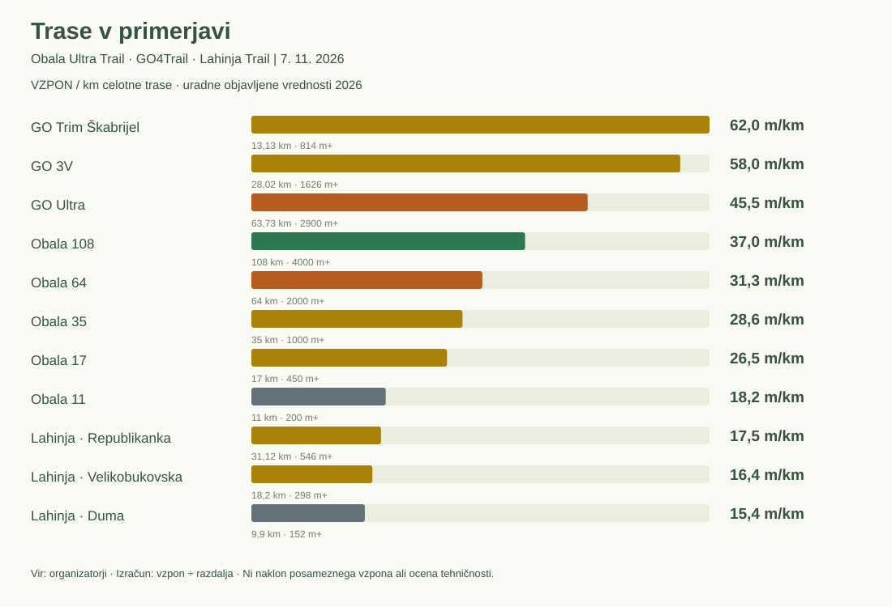

# To soboto kar tri trail tekaške prireditve

**Obala Ultra Trail, GO4Trail in Lahinja Trail ponujajo 11 tras. Kaj pravijo njihovi višinski profili in časi zmagovalcev v preteklih letih?**

V soboto bo mogoče izbirati med istrsko ultro, goriškimi vzponi in belokranjskimi griči. Na papirju so razdalje jasne: Obala ponuja od 11 do 108 kilometrov, GO4Trail tri razdalje med 13 do 64 kilometrov, Lahinja pa malo lažje preizkušnje Duma 10 km, Velikobukovska 18 km in Republikanka 31 km. Toda dolžina sama slabo pojasni, kako zahtevne so te trase. [Obala](https://obalaultratrail.si/), [GO4Trail](https://go4trail.si/), [Lahinja](https://protime.si/dogodek/lahinja-trail-2026/).

Lanska 64-kilometrska zmagovalna časa ponujata dobro izhodišče: Žan Žepič je na Obali zmagal v 5:09:24, Ivan Hrastovec na GO Ultra pa v 6:35:15. Razlika je 1:25:51, povprečna tempa pa 4:50 in 6:11 na kilometer. Pri ženskah je Agnieszka Tatarek-Konik na Obali s časom 6:35:44 za 59:45 prehitela zmagovalni čas Vike Koban na GO Ultra, 7:35:29. [Uradni rezultati Obale 2025](https://obalaultratrail.si/wp-content/uploads/2025/12/Rezultati-absolutno_2025.pdf), [GO4Trail 2025](https://go4trail.si/sl/rezultati-2025).

Graf uporablja isto merilo kot »Trase v primerjavi« v naši [analitiki](/mozgan/analitika): skupni vzpon, deljen z dolžino celotne trase.

Vzpon na kilometer je izračunan čez celotno traso, skupaj z ravninami in spusti; ne predstavlja naklona posameznega klanca. Za boljšo predstavo strmine pa je na voljo drugi pogled: »Vzpon + spust / km«, ki še vedno ne odraža pravih strmin vzponov, je pa boljši približek.

Najvišje je GO Trim Škabrijel z 62,0 metra vzpona na kilometer, sledita GO 3V z 58,0 in GO Ultra z 45,5. Obala 64 ima 31,3 metra vzpona na kilometer; GO Ultra ga na vsak kilometer zbere približno 14 metrov več.

GO 3V na 28,02 km zbere 1.626 m vzpona. Republikanka je približno tri kilometre daljša, a ima 546 m vzpona: skoraj trikrat manj. Obala 35 ima 1.000 m vzpona, zato je po gostoti vzponov med tema dvema. [GO 3V](https://go4trail.si/sl/proge/go-v3), [Obala 35](https://obalaultratrail.si/razdalje/obala-trail-35-km/), [Lahinja](https://protime.si/dogodek/lahinja-trail-2026/).

## Profil: tehnični klanci ali tekoči flow?

Obala 64 začne v Hrastovljah in se skozi notranjost Istre nadaljuje proti cilju v Izoli. Organizator za leto 2026 navaja 2.000 m vzpona, GO Ultra pa na skoraj enaki dolžini 2.900 m. Obalna trasa vodi prek Kubeda in doline Dragonje skozi istrske vasi do Strunjana in Belvederja; GO Ultra poveže več goriških vrhov. Najdaljša Obala 108 doda tudi obisk Slavnika in ima skupaj približno 4.000 m vzpona. [Obala 64](https://obalaultratrail.si/razdalje/obala-ultra-trail-64-km/), [GO Ultra](https://go4trail.si/sl/proge/go-ultra), [Obala 108](https://obalaultratrail.si/razdalje/obala-ultra-trail-108-km/).

GO4Trail zaznamujejo strmi vzponi in tehnično zahtevni spusti po kamniti, neenakomerni podlagi. GO 3V poveže Škabrijel, Sveto Goro in Sabotin, zahtevnost povečata še prehod skozi kaverno ter prečkanje Soče z raftom pri Solkanskem železniškem mostu. Organizator posebej opozarja na tehnični spust pod Sveto Goro ter kamnite in izpostavljene poti na Sabotinu. GO Ultra k temu doda daljši krog prek Gomile in Kuka. [GO 3V](https://go4trail.si/sl/proge/go-v3), [GO Ultra](https://go4trail.si/sl/proge/go-ultra).

Lahinja ostaja višinsko bolj zadržana: Duma ima razpon med 148 in 214 m nadmorske višine, Velikobukovska med 148 in 246 m, Republikanka pa do 333 m. Trase niso sestavljene le iz enega vzpona in spusta, kar pomeni, da so preizkušnje zelo tekaške in je ohranjanje tempa veliko lažje. [Razpis Lahinja 2026](https://protime.si/dogodek/lahinja-trail-2026/).

Višinski profili vseh 11 tras so v priloženem HTML-predogledu.

## Kako so se spreminjali zmagovalni časi?

Spodaj primerjamo GO Ultra 64 z Obalino približno 64-kilometrsko preizkušnjo. Ta je bila leta 2021 v rezultatih označena kot 63 km, med letoma 2022 in 2024 kot 65 km, leta 2025 pa kot 64 km. Tabela ohranja razdaljo posamezne izvedbe in posebej prikazuje oba zmagovalca.

| Dogodek | Leto | Trasa | Zmagovalec | M min/km | Zmagovalka | Ž min/km | Vir |
| --- | --- | --- | --- | --- | --- | --- | --- |
| Obala | 2021 | OGIS Ultra Trail 63km | Dalibor Petrinjak · 07:00:20 | 6:40 | Helena Mahuas · 11:14:08 | 10:42 | [Vir](https://obalaultratrail.si/wp-content/uploads/2025/12/Rezultati-absolutno_2021.pdf) |
| Obala | 2022 | OGIS Ultra Trail 65km | Martin Halasz · 5:32:57 | 5:07 | Nicol Guidolin · 6:48:48 | 6:17 | [Vir](https://obalaultratrail.si/wp-content/uploads/2025/12/Rezultati-absolutno_2022.pdf) |
| Obala | 2023 | Obala Ultra trail 65km | Aleš Svetina · 5:34:28 | 5:09 | Cornelia Oswald · 6:58:18 | 6:26 | [Vir](https://obalaultratrail.si/wp-content/uploads/2025/12/Rezultati-absolutno_2023.pdf) |
| Obala | 2024 | Obala Ultra trail 65 km | Dimitri Chapelle · 5:43:11 | 5:17 | Anna Leśniak · 7:17:16 | 6:44 | [Vir](https://obalaultratrail.si/wp-content/uploads/2025/12/Rezultati-absolutno_2024.pdf) |
| Obala | 2025 | Obala Ultra trail 64 km | Žan Žepič · 5:09:24 | 4:50 | Agnieszka Tatarek-Konik · 6:35:44 | 6:11 | [Vir](https://obalaultratrail.si/wp-content/uploads/2025/12/Rezultati-absolutno_2025.pdf) |
| GO4Trail | 2023 | GO Ultra 64 km | Niko Golob · 7:18:26 | 6:51 | Anna Kratki · 8:41:43 | 8:09 | [Vir](https://go4trail.si/sl/rezultati-2023) |
| GO4Trail | 2024 | GO Ultra 64 km | Anže Sobočan · 6:58:58 | 6:33 | Dunja Selan · 9:28:35 | 8:53 | [Vir](https://go4trail.si/sl/rezultati-2024) |
| GO4Trail | 2025 | GO Ultra 64 km | Ivan Hrastovec · 6:35:15 | 6:11 | Vika Koban · 7:35:29 | 7:07 | [Vir](https://go4trail.si/sl/rezultati-2025) |

Na GO Ultra se je moški zmagovalni čas Nika Goloba 7:18:26 iz leta 2023 spustil na 6:58:58 Anžeta Sobočana in nato na 6:35:15 Ivana Hrastovca. Zadnji rezultat je za 43:11 oziroma 9,9 % krajši od časa prvega zmagovalca. Pri ženskah so spremembe drugačne: Anna Kratki 8:41:43, Dunja Selan 9:28:35, nato Vika Koban 7:35:29. Od 2023 do 2025 je zmagovalni čas krajši za 1:06:14 oziroma 12,7 %. [2023](https://go4trail.si/sl/rezultati-2023), [2024](https://go4trail.si/sl/rezultati-2024), [2025](https://go4trail.si/sl/rezultati-2025).

Na Obalini približno 64-kilometrski preizkušnji so bili moški zmagovalni časi med letoma 2022 in 2024 blizu skupaj: Martin Halasz 5:32:57, Aleš Svetina 5:34:28 in Dimitri Chapelle 5:43:11. Leta 2025 je Žan Žepič zmagal v 5:09:24, kar je 33:47 manj kot leto prej. Pri ženskah je po Nicol Guidolin s 6:48:48 leta 2022, Cornelii Oswald s 6:58:18 leta 2023 in Anni Leśniak s 7:17:16 leta 2024 sledila Agnieszka Tatarek-Konik s 6:35:44 leta 2025. Njen zmagovalni čas je bil za 41:32 krajši od predhodnega. [Obala 2022](https://obalaultratrail.si/wp-content/uploads/2025/12/Rezultati-absolutno_2022.pdf), [2023](https://obalaultratrail.si/wp-content/uploads/2025/12/Rezultati-absolutno_2023.pdf), [2024](https://obalaultratrail.si/wp-content/uploads/2025/12/Rezultati-absolutno_2024.pdf), [2025](https://obalaultratrail.si/wp-content/uploads/2025/12/Rezultati-absolutno_2025.pdf).

Pri GO 3V se je niz krajšanja moških zmagovalnih časov leta 2025 ustavil. Na GO 3V so bili moški zmagovalni časi 3:00:53 leta 2022, 2:47:51 leta 2023, 2:40:25 leta 2024 in 2:51:16 leta 2025. Pri ženskah je bila med temi potrjenimi izvedbami najhitrejša Ana Čufer leta 2023 s 3:00:52. [2022](https://go4trail.si/sl/rezultati-2022), [2023](https://go4trail.si/sl/rezultati-2023), [2024](https://go4trail.si/sl/rezultati-2024), [2025](https://go4trail.si/sl/rezultati-2025).

Pri Lahinji je Gregor Laj na najkrajši preizkušnji zmagal tako leta 2024 kot 2025: najprej v 38:54, nato v 36:27. To je 2:27 manj časa. Velikobukovska je imela moška zmagovalna časa 1:11:36 Bineta Flajnika in 1:12:44 Danijela Topolovca; ženska pa 1:21:17 Kim Ameršek in 1:24:03 Tine Sajko. Pri tempu dodatno upoštevamo, da rezultati 2024 izrecno navajajo 9,9 in 18,2 km, leta 2025 pa zaokroženi oznaki 10 in 18 km. [Lahinja 2024](https://my.raceresult.com/308164/results), [2025](https://my.raceresult.com/327630/results).

Diagrami hitrosti zmagovalcev za vseh 11 tras so v HTML-predogledu.

## Podatkovne opombe

- Zgodovinsko okno je 2021–2025. Podatkov iz starejših preizkušenj nismo zbirali.
- Podatki za povprečno strmino posameznih tras ne odražajo dejanske strmine posameznih vzponov in spustov.
- Časi zmagovalcev ne odražajo pripravljenosti splošne skupine tekačev in tako niso takojšnja potrditev zahtevnosti tras.
- V arhivu GO4Trail je ime zmagovalke kratke trase 2024 zapisano »Nastja Mihelič«, za 2025 »Nastja Mihelčič«. Ohranjen je zapis posameznega vira; identitet nismo samodejno združili.

## Priloga: vsi zbrani zmagovalci 2021–2025

| Dogodek | Leto | Trasa | Zmagovalec | M min/km | Zmagovalka | Ž min/km | Vir |
| --- | --- | --- | --- | --- | --- | --- | --- |
| Obala | 2021 | Martinov vinski tek 11km | Gasper Bregar · 00:43:57 | 4:00 | Kristina Bele · 01:05:02 | 5:55 | [Vir](https://obalaultratrail.si/wp-content/uploads/2025/12/Rezultati-absolutno_2021.pdf) |
| Obala | 2021 | Borotalco Trail 18km | Andrej Novak · 01:35:56 | 5:20 | Lucija Krkoč · 01:43:16 | 5:44 | [Vir](https://obalaultratrail.si/wp-content/uploads/2025/12/Rezultati-absolutno_2021.pdf) |
| Obala | 2021 | Rio Mare Trail 33km | Janez Klančnik · 02:32:16 | 4:37 | Martina Potrč · 02:50:46 | 5:10 | [Vir](https://obalaultratrail.si/wp-content/uploads/2025/12/Rezultati-absolutno_2021.pdf) |
| Obala | 2021 | OGIS Ultra Trail 63km | Dalibor Petrinjak · 07:00:20 | 6:40 | Helena Mahuas · 11:14:08 | 10:42 | [Vir](https://obalaultratrail.si/wp-content/uploads/2025/12/Rezultati-absolutno_2021.pdf) |
| Obala | 2021 | PHILIPS Ultra Trail 87km | Boštjan Erjavšek · 10:20:54 | 7:08 | Tajda Knafelj · 11:31:22 | 7:57 | [Vir](https://obalaultratrail.si/wp-content/uploads/2025/12/Rezultati-absolutno_2021.pdf) |
| Obala | 2022 | Philips GO Ultra Trail 100km | Marjan Zupančič · 10:39:21 | 6:24 | Cornelia Oswald · 11:41:16 | 7:01 | [Vir](https://obalaultratrail.si/wp-content/uploads/2025/12/Rezultati-absolutno_2022.pdf) |
| Obala | 2022 | OGIS Ultra Trail 65km | Martin Halasz · 5:32:57 | 5:07 | Nicol Guidolin · 6:48:48 | 6:17 | [Vir](https://obalaultratrail.si/wp-content/uploads/2025/12/Rezultati-absolutno_2022.pdf) |
| Obala | 2022 | Obala Trail 35km | Jure Orehek · 2:48:48 | 4:49 | Irena Pišek · 3:16:19 | 5:37 | [Vir](https://obalaultratrail.si/wp-content/uploads/2025/12/Rezultati-absolutno_2022.pdf) |
| Obala | 2022 | Borotalco Trail 18km | Brian Kamstra · 1:13:55 | 4:06 | Ksenija Grm · 1:36:12 | 5:21 | [Vir](https://obalaultratrail.si/wp-content/uploads/2025/12/Rezultati-absolutno_2022.pdf) |
| Obala | 2022 | Rio Mare Trail 11km | Gašper Bregar · 0:43:35 | 3:58 | Lucija Krkoč · 0:49:12 | 4:28 | [Vir](https://obalaultratrail.si/wp-content/uploads/2025/12/Rezultati-absolutno_2022.pdf) |
| Obala | 2023 | Obala Ultra trail 108km | Jon Lihteneger Vidmajer · 10:38:37 | 5:55 | Martina Klančnik Potrč · 12:25:29 | 6:54 | [Vir](https://obalaultratrail.si/wp-content/uploads/2025/12/Rezultati-absolutno_2023.pdf) |
| Obala | 2023 | Obala Ultra trail 65km | Aleš Svetina · 5:34:28 | 5:09 | Cornelia Oswald · 6:58:18 | 6:26 | [Vir](https://obalaultratrail.si/wp-content/uploads/2025/12/Rezultati-absolutno_2023.pdf) |
| Obala | 2023 | Obala trail 35km | Primoz Porenta · 2:40:39 | 4:35 | Špela Gonza · 3:12:23 | 5:30 | [Vir](https://obalaultratrail.si/wp-content/uploads/2025/12/Rezultati-absolutno_2023.pdf) |
| Obala | 2023 | Borotalco trail 18 km | Primož Piškur · 1:17:40 | 4:19 | Maruša Cijan Brkič · 1:26:33 | 4:49 | [Vir](https://obalaultratrail.si/wp-content/uploads/2025/12/Rezultati-absolutno_2023.pdf) |
| Obala | 2023 | Rio Mare 12 km | Gašper Bregar · 0:52:04 | 4:20 | Lucija Krkoč · 0:54:24 | 4:32 | [Vir](https://obalaultratrail.si/wp-content/uploads/2025/12/Rezultati-absolutno_2023.pdf) |
| Obala | 2024 | Obala Ultra trail 108 km | Jon Lihteneger Vidmajer · 10:32:08 | 5:51 | Martina Klancnik Potrc · 12:13:08 | 6:47 | [Vir](https://obalaultratrail.si/wp-content/uploads/2025/12/Rezultati-absolutno_2024.pdf) |
| Obala | 2024 | Obala Ultra trail 65 km | Dimitri Chapelle · 5:43:11 | 5:17 | Anna Leśniak · 7:17:16 | 6:44 | [Vir](https://obalaultratrail.si/wp-content/uploads/2025/12/Rezultati-absolutno_2024.pdf) |
| Obala | 2024 | Obala trail 35 km | Jure Orehek · 2:37:27 | 4:30 | Cornelia Oswald · 3:09:48 | 5:25 | [Vir](https://obalaultratrail.si/wp-content/uploads/2025/12/Rezultati-absolutno_2024.pdf) |
| Obala | 2024 | Borotalco trail 18 km | Peter Kastelic · 1:22:06 | 4:34 | Maruša Cijan Brkič · 1:31:20 | 5:04 | [Vir](https://obalaultratrail.si/wp-content/uploads/2025/12/Rezultati-absolutno_2024.pdf) |
| Obala | 2024 | Rio Mare 12 km | Janez Žen · 0:52:24 | 4:22 | Ana Čufer · 0:53:47 | 4:29 | [Vir](https://obalaultratrail.si/wp-content/uploads/2025/12/Rezultati-absolutno_2024.pdf) |
| Obala | 2025 | Obala Ultra trail 108 km | Patrik Milata · 9:24:42 | 5:14 | Martina Klančnik Potrč · 11:47:07 | 6:33 | [Vir](https://obalaultratrail.si/wp-content/uploads/2025/12/Rezultati-absolutno_2025.pdf) |
| Obala | 2025 | Obala Ultra trail 64 km | Žan Žepič · 5:09:24 | 4:50 | Agnieszka Tatarek-Konik · 6:35:44 | 6:11 | [Vir](https://obalaultratrail.si/wp-content/uploads/2025/12/Rezultati-absolutno_2025.pdf) |
| Obala | 2025 | Obala trail 35 km | Primož Porenta · 2:41:42 | 4:37 | Nika Jančič · 3:11:21 | 5:28 | [Vir](https://obalaultratrail.si/wp-content/uploads/2025/12/Rezultati-absolutno_2025.pdf) |
| Obala | 2025 | Obala trail 17 km | Elis Filipič · 1:12:16 | 4:15 | Maruša Cijan Brkič · 1:16:27 | 4:30 | [Vir](https://obalaultratrail.si/wp-content/uploads/2025/12/Rezultati-absolutno_2025.pdf) |
| Obala | 2025 | Obala trail 11 km | Jernej Demšar · 0:43:47 | 3:59 | Julija Brus · 0:46:26 | 4:13 | [Vir](https://obalaultratrail.si/wp-content/uploads/2025/12/Rezultati-absolutno_2025.pdf) |
| Lahinja | 2024 | Trail na 9,9 km | Gregor Laj · 38:54 | 3:56 | Simona Tekavec · 51:30 | 5:12 | [Vir](https://my.raceresult.com/308164/results) |
| Lahinja | 2024 | Trail na 18,2 km | Bine Flajnik · 1:11:36 | 3:56 | Kim Ameršek · 1:21:17 | 4:28 | [Vir](https://my.raceresult.com/308164/results) |
| Lahinja | 2025 | Duma 10 km | Gregor Laj · 36:27 | 3:39 | Zdenka Pungračič Raković · 53:41 | 5:22 | [Vir](https://my.raceresult.com/327630/results) |
| Lahinja | 2025 | Velikobukovska  18 km | Danijel Topolovec · 1:12:44 | 4:02 | Tina Sajko · 1:24:03 | 4:40 | [Vir](https://my.raceresult.com/327630/results) |
| Lahinja | 2025 | Republikanka  30 km | Primož Jagodic · 2:28:27 | 4:57 | Anja Javornik · 3:13:54 | 6:28 | [Vir](https://my.raceresult.com/327630/results) |
| GO4Trail | 2022 | GO Trim 10 km | Jaka Dragoš · čas ni potrjen | — | Lucija Krkoč · čas ni potrjen | — | [Vir](https://go4trail.si/sl/rezultati-2022) |
| GO4Trail | 2022 | GO 3V 28 km | Urh Peček · 3:00:53 | 6:28 | Aja Kozinc · 3:33:02 | 7:37 | [Vir](https://go4trail.si/sl/rezultati-2022) |
| GO4Trail | 2023 | GO Trim 10 km | Tadej Vehovec · 0:55:10 | 5:31 | Maruša Cijan Brkič · 1:04:27 | 6:27 | [Vir](https://go4trail.si/sl/rezultati-2023) |
| GO4Trail | 2023 | GO 3V 28 km | Tine Žižmond · 2:47:51 | 6:00 | Ana Čufer · 3:00:52 | 6:28 | [Vir](https://go4trail.si/sl/rezultati-2023) |
| GO4Trail | 2023 | GO Ultra 64 km | Niko Golob · 7:18:26 | 6:51 | Anna Kratki · 8:41:43 | 8:09 | [Vir](https://go4trail.si/sl/rezultati-2023) |
| GO4Trail | 2024 | GO Trim 10 km | Tadej Vehovec · 0:53:57 | 5:24 | Nastja Mihelič · 1:05:31 | 6:33 | [Vir](https://go4trail.si/sl/rezultati-2024) |
| GO4Trail | 2024 | GO 3V 28 km | Tine Žižmond · 2:40:25 | 5:44 | Aja Kozinc · 3:28:48 | 7:27 | [Vir](https://go4trail.si/sl/rezultati-2024) |
| GO4Trail | 2024 | GO Ultra 64 km | Anže Sobočan · 6:58:58 | 6:33 | Dunja Selan · 9:28:35 | 8:53 | [Vir](https://go4trail.si/sl/rezultati-2024) |
| GO4Trail | 2025 | GO Trim 10 km | Tadej Vehovec · 0:51:27 | 5:09 | Nastja Mihelčič · 1:03:21 | 6:20 | [Vir](https://go4trail.si/sl/rezultati-2025) |
| GO4Trail | 2025 | GO 3V 28 km | Tadej Serdinšek · 2:51:16 | 6:07 | Tina Šatej · 3:38:11 | 7:48 | [Vir](https://go4trail.si/sl/rezultati-2025) |
| GO4Trail | 2025 | GO Ultra 64 km | Ivan Hrastovec · 6:35:15 | 6:11 | Vika Koban · 7:35:29 | 7:07 | [Vir](https://go4trail.si/sl/rezultati-2025) |
